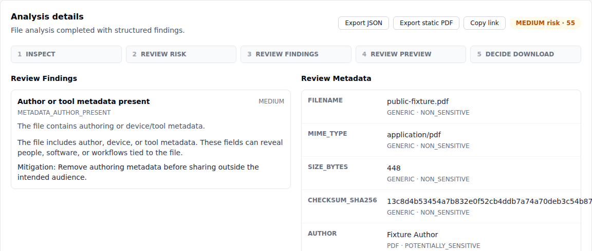

# DataGuardian: passive file and URL inspection

## Problem and implemented scope

DataGuardian gives a user an authenticated place to inspect supported files and
HTTP/HTTPS responses before deciding whether to download or open them. The active
runtime is a Go API, a Next.js frontend, and PostgreSQL, started together with
Docker Compose. The Python files provide optional validation, not a second backend.

This is a deterministic inspection tool. It does not detonate malware, execute
document actions, render websites, or infer that an input is safe because no rule
matched. The project remains under development; the repository's tests and
workflows describe validation coverage, not an independent security certification.

## Observed file and URL inspection



Chromium uploaded a generated one-page, 448-byte PDF to the local Compose
stack through an authenticated session. The Go API returned HTTP 201. The
browser reopened the saved record from analysis history and captured the
result panel above. The synthetic author field generated one medium finding.
The panel shows the risk score, finding and file metadata. The image is a
cropped, lossless WebP capture of the interface.

| Execution | Input | Observed result | What it covers |
| --- | --- | --- | --- |
| Browser → API → database → history | Valid PDF with an author and a title | `METADATA_AUTHOR_PRESENT`, 55 / MEDIUM | Upload, persistence and review in the actual dashboard |
| Go file analyzer and cleaner | 70-byte PDF syntax fragment with the same two fields | 55 / MEDIUM, author removed, title retained, original and result both 70 bytes | The supported literal subset and original preservation |
| Go URL analyzer | Synthetic HTTP 200 with inert HTML at `http://fixture.test/overview` | `URL_NO_HTTPS`, 10 / LOW | Request classification, HTTP response inspection and scoring; the test supplies DNS and an in-memory transport and makes no network request |

The URL fixture tests how the analyzer handles supplied bytes. It provides no
measurement of real DNS, TLS, dialing or egress filtering. Separate tests
exercise the address policy. No client data or real credentials appear in
the capture. [Recorded execution](https://github.com/joaosalero/dataguardian/actions/runs/45231958846/job/137893562735)

Reproduce the analyzer results from `backend-go` on a machine with the
project Go toolchain and module dependencies:

```sh
go test -count=1 -v ./internal/analysis -run '^TestInspectionEvidence$'
```

For the browser capture, start a disposable local stack from the repository
root with `docker compose up --wait --build db backend-go frontend`. The
[capture script](evidence/capture_file_result.py) creates a synthetic user,
uploads the fixture, and writes a WebP to the path provided. In a Python
virtual environment with Playwright and Pillow:

```sh
python -m playwright install chromium
python docs/evidence/capture_file_result.py file-result.webp
```

## Architecture and trust boundaries

| Boundary | Implemented behavior | Practical limit |
| --- | --- | --- |
| Browser to API | Authenticated analysis creation, owner-scoped history and artifact downloads | A compromised browser session can exercise that user's access |
| API to untrusted bytes | Size-bounded upload/response processing; passive pattern and metadata inspection | Parsing runs inside the Go API process; there is no per-analysis sandbox |
| API to remote URL | HTTP/HTTPS only, standard ports, address checks at validation and dial time, manual redirect validation, no ambient HTTP proxy | Address classification cannot attest to this deployment's routes. Egress policy requires an independent network boundary |
| API to storage | Original files and optional metadata-cleaned copies persist for later authorized downloads | Docker volumes contain retained user content; operational access to those volumes is privileged |
| Host to local stack | Compose publishes database, API and frontend on loopback by default | Local demo configuration is unsuitable for deliberate remote exposure |

The backend image uses an unprivileged runtime user. Docker isolates the service
from the host under its configured container boundary; it does not isolate one
analysis from another, and file parsing shares the API's process and access.
PDF inspection cards are generated from inert raw text snippets. They are an
inspection aid, not a faithful rendered view of every PDF page.

Source: [Compose](../docker-compose.yml), [backend image](../backend-go/Dockerfile),
[analysis handlers](../backend-go/internal/httpapi/analysis_handlers.go), and
[URL analyzer](../backend-go/internal/analysis/url_analyzer.go).

## How far should parser isolation go?

An authenticated request can supply up to 10 MiB of file data. The URL reader
accepts up to 2 MiB of response data and caps redirects at three. These bounds
apply to inputs. They cannot cap the work or memory a parser consumes, and a
parser in the API process shares its filesystem permissions, database access
and failure domain.

Two changes reduce pressure within that boundary. EXIF directory entries now
borrow read-only spans of the TIFF buffer while metadata is extracted. Multiple
entries referring to the same span no longer allocate independent copies of its
contents. The PDF extractor consumes one literal match at a time and stops
once all three supported fields have values. The resulting strings still
belong to the analysis result. Neither change adds a parser sandbox.

The API also rejects the IPv4 shared address range in the same check used for
DNS answers, literal destinations and dialing. Standard private-address checks
alone do not classify shared address space. Deployments with custom routes or
address translation still need an egress policy reflecting their own network.
[IANA IPv4 Special-Purpose Address Registry](https://www.iana.org/assignments/iana-ipv4-special-registry/iana-ipv4-special-registry.xhtml)

**Decision for the local preview.** Keep the current deployment and passive
file formats. A shared worker process could move crashes away from the API
but would share state across jobs. Per-job isolation is justified before
accepting adversarial public workloads or adding a native parser with a
larger trust surface. It requires a supervisor, bounded IPC, cancellation,
resource limits and reliable cleanup.

A candidate design would give each file job only its input and a private
temporary directory, with no database credentials or network access. The
broker would retain ownership checks and validate size and shape of returned
results. URL fetching would have a separate, restricted egress path. Before
adopting that design, test termination, storage cleanup, the rejection of
oversized results and behavior when the worker is unavailable. No worker
or per-job isolation is included in this release.

**Persistence trade-off.** The handler creates the analysis in
`PROCESSING`, saves its parts, then marks it complete. A database error after
creation can leave an incomplete analysis visible in history. Startup orphan
cleanup handles unreferenced files, not partially written database results.
A follow-up should test interrupted writes and select a transaction or an
explicit failure/reconciliation state across database and filesystem writes.
That decision is independent of parser isolation.

## Explainable risk model

`ScoreFindings` selects a fixed score from the highest implemented finding severity.
It is not a calibrated probability, a vulnerability severity standard, or an
additive score. Finding count does not increase the score.

| Findings | Score | Level |
| --- | --- | --- |
| None, or low severity only | 10 | LOW |
| At least one medium severity; no high severity | 55 | MEDIUM |
| At least one high severity | 85 | HIGH |

Every finding contributes a driver containing its code, severity, and title. For
example, a plain-text `eval(` match produces a medium finding; a raw PDF
JavaScript marker produces a high finding. These string rules can produce false
positives and miss encoded, compressed, or unfamiliar content. LOW means the
implemented rules did not find a higher-severity signal; it is not a safety verdict.

Source: [file analyzer and scoring](../backend-go/internal/analysis/file_analyzer.go)
and [URL content checks](../backend-go/internal/analysis/url_analyzer.go).

## Metadata removal and preservation

JPEG cleaning removes EXIF APP1 segments. PDF cleaning targets the supported
literal author, producer, and creation-date fields. Matched PDF fields are replaced
with equal-length whitespace so downstream objects and cross-reference tables
retain their original byte offsets. The source bytes remain unchanged.

The PDF operation is intentionally lightweight. It does not parse all PDF syntax,
guarantee removal of compressed or complex metadata, preserve digital signatures,
or remove scripts and embedded objects. A metadata-cleaned artifact remains
untrusted. Keeping original and cleaned artifacts distinct makes that limitation
visible instead of presenting metadata removal as malware disarmament.

Source: [metadata extraction and cleaning](../backend-go/internal/analysis/file_metadata.go)
and [metadata regression tests](../backend-go/internal/analysis/file_metadata_test.go).

## Validation and review

From a complete checkout with the documented development dependencies:

```bash
cd backend-go
go test ./...
```

```bash
pytest tests/test_backend_mode_contract.py
```

The Go tests cover analyzer behavior and the PDF byte-offset preservation
regression. The architecture contract checks the single Go runtime and local-only
default published ports. The optional browser flow requires the running stack;
see the [README](../README.md#e2e-testing). No benchmark or detection-accuracy
result is claimed here.

## Engineering decisions

- Reuse one analysis flow for supported uploads and remote-file responses.
- Keep detection and explanations deterministic and inspectable.
- Bound network content and validate redirect/dial destinations without introducing
  an active browser or a second fetching pipeline.
- Retain artifact ownership checks and make sanitization limits explicit.
- Preserve the compact Go runtime while documenting the separate sandbox and
  network isolation work that would be needed for stronger adversarial containment.
